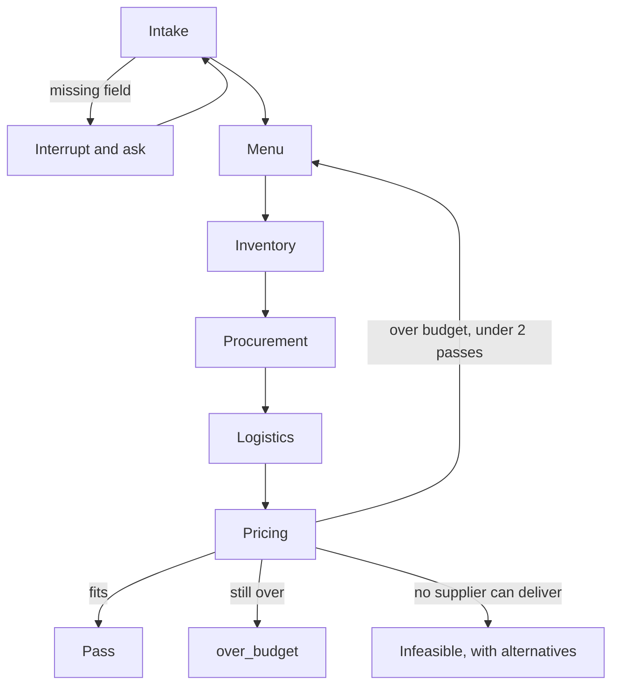

# Multi-Agent Catering Operations

Codename: Handa

Handa is a catering operations desk for **Mesa Clara**, a fictional caterer in Quezon City. You describe an event in a sentence. A model files the brief, chooses the dishes, and writes the client sentence. Python computes every quantity, peso, and time.

This is a personal portfolio build by Charlene Cordero, based on the public problem statement from the Code; Without Barriers Hackathon (id8nxt): one event brief has to become a menu, a shopping list, a timeline, and a quotation. It is not a hackathon submission. Mesa Clara, the recipes, and the prices are sample data. It is not affiliated with id8nxt or any caterer, and it makes no claim about a real client's results.

## Architecture

```mermaid
flowchart LR
  browser[Browser] --> api[FastAPI]
  api --> graph[LangGraph]
  graph --> llm[Intake, menu, and quote summary]
  llm --> model[Mock model or OpenAI-compatible endpoint]
  graph --> tools[Python tools]
  tools --> book[Price book]
  llm --> chroma[Chroma binder]
```



Each arrow is an `agent_messages` handoff. The trace tab streams them as the nodes finish.

| Node | Who decides | What stays in Python |
| --- | --- | --- |
| Intake | LLM calls `submit_event`, then a follow-up question if a field is missing | The tool validates `EventRequest`. One bad payload is repaired. A second failure is `review_queue` |
| Menu | LLM calls `search_recipes`, `check_diet`, and `get_budget_per_head`, then names dishes and a rationale. On a later pass it says which premium dishes it is dropping | Portions, book cost, and the diet lock. A selection that breaks the diet rule is replaced by the price-book menu |
| Inventory | Python | `net_shortfall` |
| Procurement | Python | lead time, minimum order, supplier switch |
| Logistics | Python | `backward_schedule` |
| Pricing | LLM writes the client sentence after `read_quote` | The quote itself. A sentence that invents a number is dropped |

The Trace tab marks each line `LLM`, `tool`, or `python`. Default `HANDA_LLM_PROVIDER=mock` is a scripted model that still makes those tool calls, so the demo needs no key. Set the provider to `openai` and point the base URL at any OpenAI-compatible server, including Ollama:

```bash
HANDA_LLM_PROVIDER=openai
HANDA_LLM_BASE_URL=http://127.0.0.1:11434/v1
HANDA_LLM_API_KEY=ollama
HANDA_LLM_MODEL=llama3.1
```

Use a model that can call tools. The model id is whatever that server currently serves.

Cost-down passes, up to two:

1. Swap premium dishes for the house alternate.
2. Drop the service style one step: plated to buffet, buffet to drop-off.

Rice and drinks include a 5% buffer. Vegetarian plates get tofu adobo. A venue outside Quezon City adds a driver and a ₱900 travel fee. The book has 40 recipes, 6 suppliers, and 6 sample requests, from `python -m handa.sample_data.generate` with seed `20261115`.

Three disruptions rerun only the nodes they touch:

- **Supplier delay** adds 30 days to Balintawak and reruns procurement onward.
- **Spoilage** zeroes perishable stock and reruns inventory onward.
- **+15 guests** reruns from the menu. Intake is not asked again.

## Run it

One command, from this directory. It creates a virtualenv if you don't have one, installs the package, runs the tests, and starts the desk:

```bash
make demo
```

Open [http://127.0.0.1:43123](http://127.0.0.1:43123).

Tests only:

```bash
make test
```

Server only, after `make install`:

```bash
make run
```

`PORT` wins over `HANDA_PORT` when a host sets it. Locally the port is 43123.

No API key is required. The default provider is `mock`.

## Demo script

The Intake tab has six sample requests from the fixed-seed book. Nothing here is a client result.

1. **Town hall.** Paste the sample and send it. The trace runs intake, menu, inventory, procurement, logistics, then pricing. Open Menu, Shopping list, Timeline, and Quote.
2. **Debut, no budget.** The desk stops and asks for the budget. Answer with a number. If the first menu is over that budget, the next pass swaps premium dishes.
3. **Budget that cannot close.** After the cost-down passes, the file is flagged `over_budget`. You can issue that file or cancel it. Issuing does not change the price book.
4. **Same-day lunch.** A supplier that cannot deliver in time is switched. The shopping list shows the switch.
5. On a finished file, **+15 guests** reruns from the menu, **Spoilage** renets perishable stock, and **Supplier delay** rechecks procurement.

Curl, with the server running:

```bash
curl -s http://127.0.0.1:43123/api/health
curl -s -X POST http://127.0.0.1:43123/api/runs \
  -H 'content-type: application/json' \
  -d '{"text":"Northwind BPO needs a corporate lunch for 60 guests in 21 days at 12:00 in Taguig. Budget 45000 pesos. No pork. 8 vegetarian guests."}'
```

Take `run_id` from that response. The trace is a server-sent stream:

```bash
curl -N http://127.0.0.1:43123/api/runs/RUN_ID/events
```

A terminal-only pass, no browser:

```bash
.venv/bin/python -m handa.cli town-hall
```

## Configuration

Copy the example file and edit it. `.env` is gitignored.

```bash
cp .env.example .env
```

| Variable | Default | What it does |
| --- | --- | --- |
| `HANDA_LLM_PROVIDER` | `mock` | `mock` runs the scripted tool-calling model. `openai` calls `HANDA_LLM_BASE_URL` |
| `HANDA_LLM_BASE_URL` | `https://api.openai.com/v1` | OpenAI-compatible `/chat/completions`, including Ollama at `http://127.0.0.1:11434/v1` |
| `HANDA_LLM_API_KEY` | empty | Required only when the provider is `openai`. Ollama accepts any non-empty placeholder |
| `HANDA_LLM_MODEL` | `gpt-4o-mini` | Model id on that server |
| `HANDA_LLM_TIMEOUT_S` | `40` | Per request |
| `HANDA_EMBEDDINGS` | `hash` | Local hashing vectors. The store is still Chroma |
| `HANDA_DATA_DIR` | `.handa` | Where the Chroma index is written |
| `HANDA_HOST` | `0.0.0.0` | Bind address |
| `HANDA_PORT` | `43123` | Port, unless `PORT` is set |
| `HANDA_LOG_LEVEL` | `INFO` | Python log level |
| `HANDA_MAX_REVISIONS` | `2` | Automatic cost-down passes before a person decides |

No API key is required for the default mock model. A real key stays in `.env`, which is gitignored. The mock model is what `make demo` runs.

## Tests

```bash
make test
```

The suite covers the price book (one price per item, portion math, vegetarian split, pork exclusion, the debut cost-down, the impossible budget, same-day lead times), the budget-rule guardrail, Chroma retrieval, the full graph including approval, send-back, cancel, and exception, and the HTTP API.

## Free-tier deploy

The app is one Python process. Mock mode needs no database and no API key. On boot it rebuilds the Chroma index from the sample docs, so an ephemeral disk is enough.

**Render.** Create a free web service from this repo.

- Build command: `pip install .`
- Start command: `python -m handa`
- Environment: `HANDA_LLM_PROVIDER=mock`

Render sets `PORT`. Handa listens on that. Free instances sleep when idle, and the in-memory checkpointer forgets in-flight approvals on restart. That is fine for a demo. A finished quotation is not stored anywhere except the running process.

**Fly.io or any host that runs a container.** The `Dockerfile` starts the same process. Check the host's current allowance before you rely on it. A mock-mode deploy still needs no key.

```bash
docker build -t handa .
docker run --rm -p 43123:43123 handa
```

Do not put this on the public internet without an auth layer. The decision endpoint is open on purpose so the demo can be clicked through.

## Scope

In this slice:

- LangGraph nodes in order: intake, menu, inventory, procurement, logistics, pricing. Pricing loops back to menu at most twice when the quote is over the budget, then the file is flagged `over_budget`.
- Intake is an LLM turn: it calls `submit_event`, the tool validates `EventRequest`, and the model drafts the follow-up when a field is missing. One failed payload is repaired. A second failure is `review_queue`.
- Menu is an LLM turn: `search_recipes`, `check_diet`, and `get_budget_per_head`, then a rationale and a dish list. On a later pass the rationale says which premium dishes are being swapped. Portions and pesos are still computed in Python, and a diet violation is rejected.
- Pricing is an LLM sentence after `read_quote`. A sentence that contains a number the tool did not return is discarded.
- The default model is the mock, which performs those same tool calls with no key. `HANDA_LLM_PROVIDER=openai` uses any OpenAI-compatible server.
- Inventory nets need against on-hand stock. Procurement applies minimum orders and switches supplier when the cheaper one cannot meet the lead time. Logistics walks the timeline backward from service.
- Every handoff is an `agent_messages` record and is streamed to the Trace tab.
- Disruptions: supplier delay, spoilage, and +15 guests. Each one reruns from the first affected node, not from intake.
- If no supplier can deliver, the result is `infeasible` and names an alternative (move the date, or drop the dish).
- Off-schema model output gets one repair. If that also fails, the file is `review_queue`. A quote sentence that invents a peso amount is dropped. A recorded model in the tests covers a bad tool payload, a bad menu choice, and a made-up total.
- UI tabs: Intake, Trace, Menu, Shopping list, Timeline, Quote. Issuing or cancelling is a recorded human decision on a finished file.
- Pytest covers portion scaling, netting, minimum orders, supplier switching, backward scheduling, the quote formula, the interrupt, the cost-down cap, the three disruptions, tool calling, and the repair path.

Out of scope:

- The mock model is scripted. It calls the same tools and schemas a live model does, but it is not a neural network. A live model can choose different legal dishes, so the peso figures in the demo script are the mock's.
- Neural embeddings. Hashing vectors match shared words.
- PDF, email, or chat delivery of the quote.
- Purchase orders that are actually sent, live stock feeds, or consolidated buying across several events.
- Named staff, payroll, driving directions, traffic, or weather.
- Deposits, invoices, or payment.
- Accounts, or a database of issued quotes. Restart the process and open files are gone.
- Free-form menu editing. Cost-down follows the swap table, not prose.
- More than the three disruption buttons.

Sample pesos in the app come from seed `20261115`. They are not a client's results and they are not catering advice.

## CV description

Handa is a catering operations desk for a fictional Quezon City caterer. A LangGraph pipeline uses a tool-calling model for intake, the menu, and a one-line client summary, and uses Python for every quantity, peso, supplier choice, and clock time. Intake files an event through a validated tool and asks a follow-up when a field is missing. The menu agent searches a Chroma recipe index, checks diet tags, and reads the budget per guest before it names dishes. A quote that is over budget is revised at most twice, then flagged. The default run is a scripted model with no API key. The same graph can call any OpenAI-compatible server, including a local Ollama. It does not send purchase orders, take payment, or keep the file after a restart.
